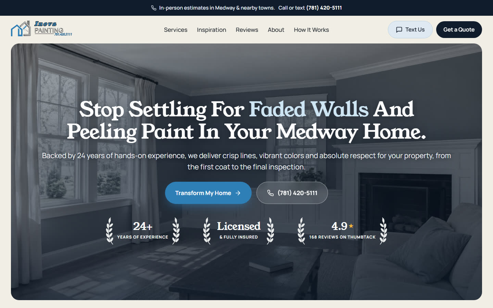
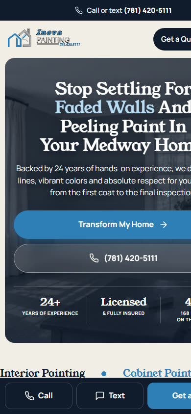

<div align="center">


# Inova Painting Corp — Website

**Site one‑page de alta conversão para uma empresa de pintura residencial e comercial em Medway, Massachusetts.**

[](#)
[](#)
[](#)
[](#)
[](#)
[](#)
[](#)

</div>

<p align="center">
  
  &nbsp;
  
</p>

---

## ✦ Sobre o projeto

A Inova Painting Corp é liderada por **Junior Batista**, com cerca de **24 anos de experiência** pintando casas em Massachusetts. O site existe para uma coisa: **transformar visitantes (vindos de Google Ads, Local Services, Google Business e Meta) em pedidos de orçamento** — formulário, ligação ou mensagem de texto.

Tudo é **HTML, CSS e JavaScript puros**, sem etapa de build: os arquivos sobem direto para a hospedagem.

## ✦ Destaques

| | |
|---|---|
| 🎨 **Visual premium** | Tipografia *Young Serif* + *Manrope*, paleta da marca (navy `#101B2D`, azul `#2F7EB7`, prata), hero emoldurado com selos de confiança. |
| 🧊 **3D em tempo real** | O ícone da marca extrudado em Three.js, com material metálico, entrada animada e parallax no mouse. |
| 🎬 **Motion orquestrado** | GSAP + ScrollTrigger + Lenis: títulos que sobem palavra por palavra, fotos reveladas como uma passada de rolo, parallax e marcas d’água. |
| ⭐ **Prova social real** | 44 avaliações reais do Thumbtack em um marquee de duas fileiras, com selo **4.9 ★ · 168 reviews · Top Pro 2020–2025**. |
| 🗺️ **Mapa personalizado** | Leaflet com tiles tingidos na cor da marca, rotas animadas da sede até cada cidade, anéis de 10/20 mi e distâncias calculadas. |
| 📱 **Mobile first de verdade** | Cards de serviço deslizáveis, barra fixa *Call · Text · Get a Quote*, alvos de toque ≥ 44 px, zero rolagem horizontal. |
| ✍️ **Sem palavras órfãs** | `text-wrap: balance/pretty` + script que une as duas últimas palavras de cada bloco, do desktop ao celular. |
| ♿ **Acessível** | Semântica correta, foco visível, navegação por teclado nos carrosséis e `prefers-reduced-motion` respeitado em todas as animações. |

## ✦ Seções da página

| # | Seção | Objetivo |
|---|---|---|
| 1 | **Hero** | Promessa principal + CTA *Transform My Home* + selos (24+ anos, licenciado, 4.9 ★ Thumbtack). |
| 2 | **Faixa de serviços** | Marquee com todos os serviços. |
| 3 | **About** | História e experiência do Junior Batista. |
| 4 | **Services** | Interior, Exterior, Commercial e Adicionais — abas com rotação automática no desktop e cards no mobile. |
| 5 | **Inspiration** | Galeria com miniaturas, arraste com física de mola e teclado. |
| 6 | **Reviews** | Selo do Thumbtack + 44 avaliações reais em movimento. |
| 7 | **Why Inova** | Diferenciais + ícone 3D. |
| 8 | **How it works** | 3 passos até o orçamento. |
| 9 | **Service area** | Mapa com as 12 cidades atendidas e distâncias. |
| 10 | **FAQ** | Perguntas frequentes (também em *schema* `FAQPage`). |
| 11 | **Get your quote** | Formulário com validação, estados de envio/erro/sucesso. |

## ✦ Stack

Sem dependências instaladas — tudo via CDN com versão fixa:

| Biblioteca | Versão | Uso |
|---|---|---|
| [GSAP](https://gsap.com) + ScrollTrigger | 3.12.5 | Animações e scroll |
| [Lenis](https://github.com/darkroomengineering/lenis) | 1.1.13 | Scroll suave |
| [Three.js](https://threejs.org) | 0.160.0 | Ícone 3D (`SVGLoader` + `RoomEnvironment`) |
| [Leaflet](https://leafletjs.com) | 1.9.4 | Mapa da área atendida (tiles Esri, sem chave de API) |
| [Web3Forms](https://web3forms.com) | — | Envio do formulário por e‑mail, sem backend |
| Google Fonts | — | *Young Serif* e *Manrope* |

## ✦ Estrutura

```text
.
├── index.html               # página principal (conteúdo, SEO, JSON‑LD)
├── privacy-policy.html      # Privacy Policy  → /privacy-policy
├── terms-of-use.html        # Terms of Use    → /terms-of-use
├── 404.html                 # página de erro
├── card.html                # cartão de visitas digital → /card (aliases /links, /contact, /bio)
├── .htaccess                # HTTPS, URLs limpas, cache, compressão, segurança, antispam
├── robots.txt               # produção
├── robots-staging.txt       # servido só no ambiente de teste (bloqueia rastreamento)
├── sitemap.xml
├── site.webmanifest         # PWA / ícones
├── favicon.ico
├── humans.txt               # quem fez o site
├── llms.txt                 # resumo do negócio para assistentes de IA
├── .well-known/security.txt
├── assets/
│   ├── css/style.css
│   ├── css/card.css         # estilo do cartão de visitas
│   ├── js/main.js           # motion, carrosséis, formulário, mapa, anti‑órfãs
│   ├── js/logo3d.js         # cena Three.js do ícone
│   ├── js/antispam.js       # time‑trap, honeypot, filtro de links, e‑mail ofuscado
│   ├── js/page.js           # script leve das páginas internas
│   ├── js/card.js           # compartilhar / copiar link do cartão
│   ├── inova-painting.vcf   # contato (vCard) do botão Save Contact
│   ├── icons/               # favicons e ícones do manifest
│   └── img/                 # marca, og-image, qr-card (svg/png), homes/ e sections/
├── scripts/clean-cache.*    # atualiza o ?v= de CSS/JS (bash e PowerShell)
└── docs/                    # prévias usadas neste README
```

## ✦ Rodando localmente

Os módulos ES (3D) não carregam via `file://`, então use qualquer servidor estático:

```bash
# Python
python -m http.server 5510
# ou Node
npx serve .
```

Abra **http://localhost:5510**.

## ✦ Domínio e ambiente de teste

- **Produção:** https://inovapaintingpro.com — URLs sem `.html` (`/privacy-policy`, `/terms-of-use`, `/card`). O `.htaccess` redireciona qualquer `.html` e barras finais para a versão limpa.
- **Teste:** se o mesmo código for publicado em `inova.escolats.com.br`, o `.htaccess` envia `X-Robots-Tag: noindex` e serve o `robots-staging.txt`, para o Google não indexar o ambiente de teste.

## ✦ Cartão de visitas (`/card`)

Página no estilo *link na bio* para o QR code do cartão físico, Instagram e assinatura de e‑mail: ligar, mandar SMS, e‑mail, pedir orçamento, site, Instagram, Facebook, reviews do Thumbtack, **Save Contact** (vCard) e **Share**. Fica fora do sitemap (`noindex`).

- QR code para impressão: `assets/img/qr-card.svg` (vetor) e `assets/img/qr-card.png` (1024 px), apontando para `https://inovapaintingpro.com/card`.
- `/links`, `/contact`, `/bio` e `/vcard` redirecionam para `/card`.

## ✦ Limpar cache após cada deploy

O HTML nunca fica em cache; CSS e JS ficam por 1 ano e são renovados pelo `?v=` nos links. Depois de alterar CSS ou JS:

```bash
bash scripts/clean-cache.sh
# ou, no Windows
powershell -ExecutionPolicy Bypass -File scripts/clean-cache.ps1
```

Se ainda aparecer a versão antiga: **hPanel → Avançado → Cache Manager → Purge all**.

## ✦ Publicando na Hostinger

1. No hPanel, abra **Arquivos → Gerenciador de arquivos** do domínio.
2. Envie para `public_html/`: os arquivos `.html` (incluindo `card.html`), `.htaccess`, `robots.txt`, `robots-staging.txt`, `sitemap.xml`, `site.webmanifest`, `favicon.ico`, `humans.txt`, `llms.txt` e as pastas `assets/` e `.well-known/`. Não envie `docs/`, `scripts/`, `README.md` nem arquivos internos (o `.htaccess` também bloqueia esses caminhos).
3. Ative o **SSL** do domínio.
4. A cada atualização de CSS/JS, rode o script de *clean cache* (acima).

## ✦ Checklist antes de publicar

- [ ] **Formulário:** colar a *access key* da Web3Forms no campo `access_key` do `index.html`.
- [ ] **Facebook:** inserir a URL exata da página no rodapé, no `card.html` e no `sameAs` do JSON‑LD.
- [ ] **Logo:** o `LOGO-OFICIAL.svg` recebido está sem o “G” (“PAINTIN”); o site usa ícone + `TEXTO.svg`. Substituir quando houver a versão corrigida.
- [ ] **Reviews do Thumbtack:** confirmar que a exibição das avaliações no site é permitida pelos termos da plataforma (com atribuição e link para o perfil).
- [ ] **Imagens:** substituir as imagens ilustrativas por fotos reais de obras da Inova.
- [ ] **Imagem de compartilhamento:** definir uma `og:image` própria.
- [ ] **Google Search Console:** enviar o `sitemap.xml` após o go‑live.
- [ ] **Textos legais:** revisar Privacy Policy e Terms of Use com um advogado nos EUA (são modelos, não aconselhamento jurídico).
- [ ] **Analytics/Ads:** se instalar Google Ads, GA4 ou Meta Pixel, atualizar a seção *Cookies* da Privacy Policy.

## ✦ SEO local

- `<title>` e *meta description* focados em **House Painters in Medway, MA**.
- JSON‑LD **`HousePainter`** com endereço, telefone, horário e as 12 cidades em `areaServed`.
- JSON‑LD **`FAQPage`** espelhando o FAQ visível.
- Hierarquia de títulos, `alt` descritivos, imagens responsivas (`srcset`) e carregamento *lazy*.

## ✦ Conteúdo e créditos

- **Avaliações:** reproduzidas do [perfil da Inova no Thumbtack](https://www.thumbtack.com/ma/medway/interior-painting/inova-painting-corp/service/352176700622430228), com link para a fonte.
- **Imagens das seções e galeria:** ilustrativas — não representam obras documentadas da Inova.
- **Mapa:** tiles © Esri, © OpenStreetMap contributors.
- **Marca:** logotipo e identidade visual © Inova Painting Corp.

---

<div align="center">

**Inova Painting Corp** · 11 Villa Street, Medway, MA 02053 · (781) 420‑5111

Desenvolvido por **[Eu Sou TS](https://eusouts.com.br/)**

</div>
